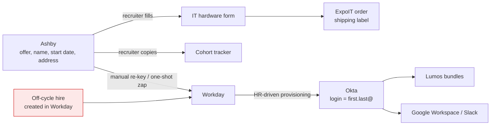
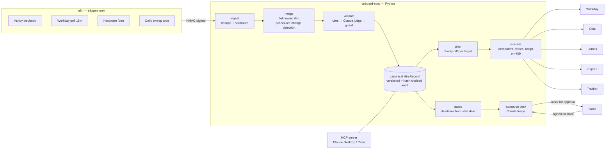

# Deliverable 1: Systems map

**Read time:** about 20 minutes. **Slice built:** change propagation, implemented as a reconciliation engine. Validation and exception monitoring run on the same spine.

---

## 1. Where the data lives

| System | Role in onboarding | What it holds for a new hire | How it's fed today | Interface used by the prototype |
|---|---|---|---|---|
| **Ashby** (ATS) | Where the hire starts | Legal and preferred name, personal email, home address, start date, title, department, manager, location, background-check status | Recruiters edit it | Webhooks (offer accepted, candidate/offer updated, offer rescinded) |
| **Workday** (HRIS) | System of record once the hire starts | Worker ID, legal name, hire date, job, supervisory org, manager, location code, home address | Re-keyed by hand from Ashby. **Off-cycle hires are created directly in Workday.** | RaaS report polled by n8n; Hire / Change / Rescind business processes |
| **Okta** (IdP) | Identity | Login and work email (derived from the name, effectively permanent), profile, activation date | HR-driven from Workday, or by hand | Users API (returns 409 on a duplicate login) |
| **Lumos** | App access | Role-based access bundle request | Requested by hand | Access-request API |
| **IT hardware form → ExpoIT** | Equipment | Equipment profile, ship-to address, deliver-by date | The hire or a recruiter fills in the form | Form webhook in; order API out (PATCH only while status is `ordered`) |
| **Cohort tracker** (Google Sheet) | Coordination | Cohort, start date, team, manager, status, plus human-only columns (buddy, notes) | Typed by hand | Sheets API, upsert by `Hire ID` |
| **Slack** | People | Nudges and approvals | Ad-hoc DMs | Block Kit messages and signed interactivity callbacks |
| **n8n / Zapier** | Glue | Not applicable | One-shot zaps | n8n handles webhooks, polling and cron. Zapier zaps are retired into n8n. |
| **Google Workspace, Highspot** | Downstream of Okta, and enablement | Mailbox and content enrolment | Okta provisioning | Out of scope; they consume Okta |

## 2. How data moves today

Every arrow is a push that fires once, triggered by a single event. Nothing later checks whether the downstream system still matches the upstream one.

## 3. Where it breaks

| Symptom from the brief | Root cause | Concrete impact |
|---|---|---|
| **Changes don't propagate.** A start date, name or address is edited after the offer, or an off-cycle hire appears. | Automations chain events together instead of converging on a state. A second edit doesn't fire again, and a hire created in Workday has no Ashby event at all. | The start date moves two weeks, but the laptop still ships to the old schedule, the Okta account activates two weeks early (a security issue), and the tracker shows the wrong cohort. |
| **Bad data cascades** | No check runs at the point where the record becomes canonical, so each downstream system trusts its upstream. The Okta email is derived from the name. | A "Jhon" typo becomes `jhon.okafor@` in Okta, Google and Slack. Fixing it afterwards means a rename or an alias across systems. |
| **Nobody watches the gates** | Deadlines are relative to the start date, but no system owns them. When the start date moves, every deadline moves silently. | The hardware form arrives at T−2 instead of T−7. An off-cycle hire skips Ashby and so has no background check on file. |

**The root cause in one line:** there is no canonical hire record and no reconciliation loop. All three symptoms are that same missing piece, seen from different sides.

## 4. Who owns which field

Change propagation is only safe if the engine knows whose edit wins. The rules are in `ownership.py`:

| Field group | Owner before day 1 | Owner from day 1, and for off-cycle hires |
|---|---|---|
| Legal and preferred name, personal email, title, department, manager, location, start date, home address, employment type | **Ashby** | **Workday** |
| Background-check status | Ashby (the vendor integration reports there) | Ashby |
| Ship-to address, equipment profile, "hardware form submitted" | IT hardware form | IT hardware form |
| Work email / login | Okta, set once at creation and never re-derived | Okta |

An edit from a system that doesn't own the field is never applied silently. If that system is also a target (a person editing Workday directly before day 1), the planner's three-way diff turns the edit into a **conflict** for a person to decide.

## 5. Target architecture

**Level-triggered, not edge-triggered.** An event only updates the desired state, in one transaction. Convergence is the reconciler's job. It runs straight away for latency and again in the daily sweep for correctness, so a crash or a missed webhook loses nothing.

## 6. The slice I chose, and why

| | **Change propagation** | Cross-system validation | Exception monitoring |
|---|---|---|---|
| Fixes the root cause (no canonical state, no convergence) | ✅ | Only partly. It needs to know what to validate *against*, which means the canonical record anyway. | ❌ It observes but doesn't fix |
| Needs real code that low-code can't reach (the premise of the role) | ✅ Diffing, ordering, idempotency, conflicts, partial failure | ~ Rules and lookups; a zap with a filter covers most of it | ❌ A cron plus a Slack message is native n8n |
| Covers the other two | ✅ Validation becomes the admission gate and monitoring becomes a view of the ledger | ❌ | ❌ |
| Handles off-cycle hires | ✅ Multi-source ingest that matches and adopts existing records | ❌ | ❌ |
| Cost of today's failure | Highest: wrong-date shipping, early access, wrong cohort | High | Medium |

**My argument for it:** validation and monitoring are *components* of a reconciliation engine, not alternatives to one. Build the engine and both come almost for free: validation is the gate in front of every write, and monitoring is a query over gates and exceptions. Build either of the others alone and you still have to build the engine later. Change propagation is also the slice where low-code is the wrong tool, which is what this role exists for.

**Kept deliberately thin:** validation is 8 deterministic rules plus a Claude location judge. Monitoring is 5 gates with nudges. That's enough to show the spine carries both.

## 7. What I chose not to add

- **No Temporal, Airflow or Prefect.** n8n plus a retry table and a daily sweep is enough at this volume.
- **No Workato or Tray.** n8n already covers that layer.
- **No unified HR API such as Merge or Finch.** There are only two HR sources.
- **No new queue.** The SQLite/Postgres retry table is the outbox.
- **The one thing I'd ask for** is a Postgres schema next to n8n's database, for the canonical store and the audit ledger. That's a new schema, not a new tool.
